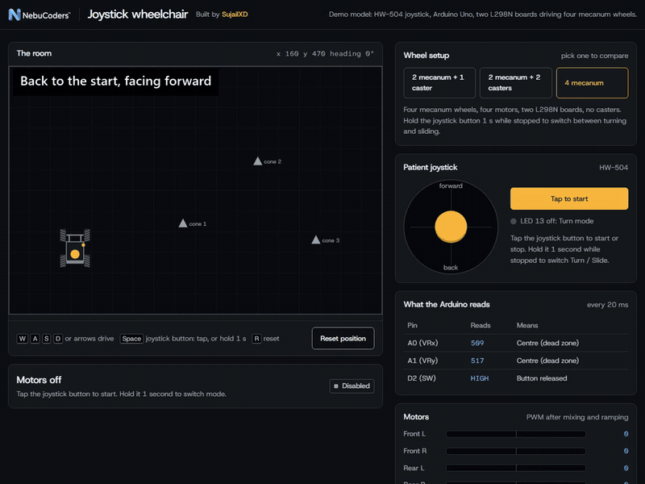
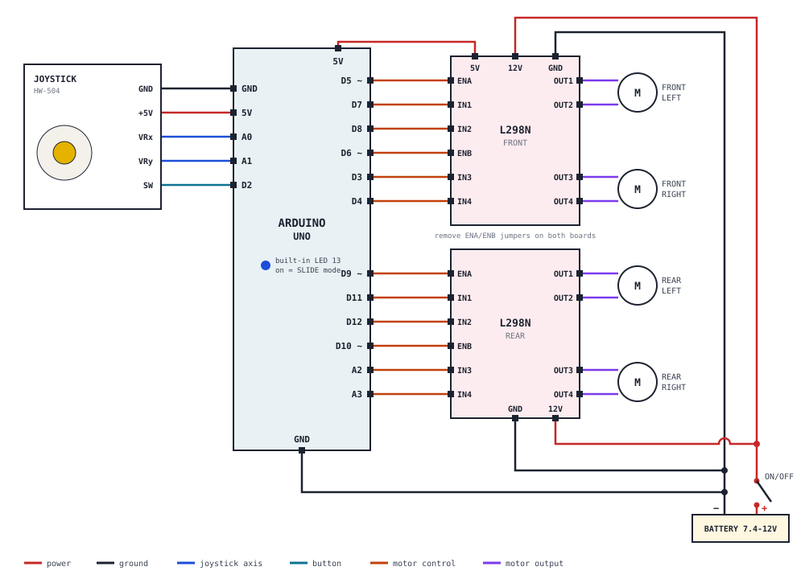
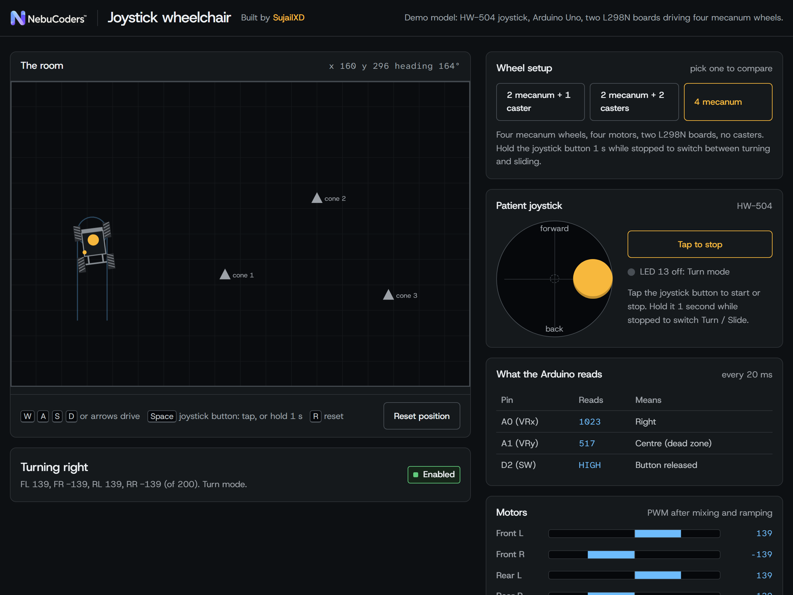
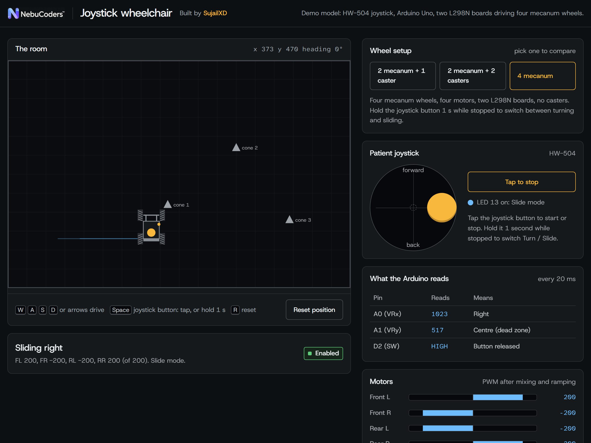
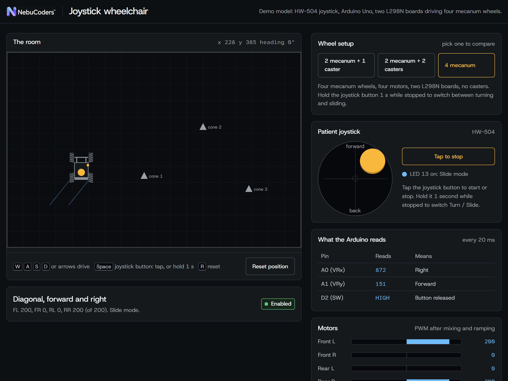
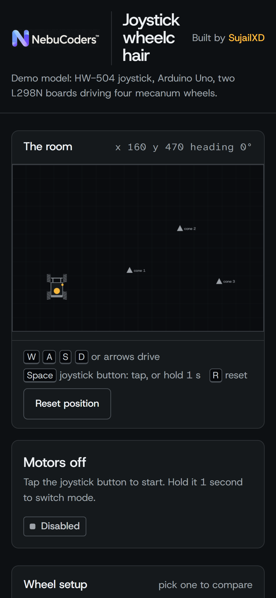

<p align="center">
  
</p>

<h1 align="center">Joystick-Controlled Wheelchair: 4 Mecanum Wheels</h1>

<p align="center">
  A demo wheelchair that one joystick drives, turns, and <b>slides sideways</b><br>
  without changing the way it faces. Arduino Uno, HW-504 joystick, two L298N drivers.
</p>

<p align="center">
  
  
  
  
  
</p>

<p align="center">
  
</p>

<p align="center"><a href="media/demo.mp4"><b>Watch the full demo video (46 s)</b></a> &nbsp;·&nbsp; <a href="https://sujailxd.github.io/Joystick-Wheelchair/"><b>Live demo site and simulator</b></a></p>

---

## What it does

People who cannot push a wheelchair by hand can often still move one hand. This project shows how a **single joystick** can drive a wheelchair, and because it stands on **four mecanum wheels**, it can do something an ordinary wheelchair cannot: **slide sideways** and move **diagonally** while still facing the same way. That helps in tight spaces, like lining up beside a table or a bed without turning around.

- **Turn mode:** stick up/down drives forward and back, left/right turns the chair.
- **Slide mode:** left/right slides the chair sideways; up + right goes diagonally.
- **One button:** the joystick's own push button starts, stops and switches modes. No extra buttons.

## How it works

A mecanum wheel has small rollers set at 45°, so it pushes partly forward and partly sideways. Spinning the four wheels in different combinations makes those sideways pushes cancel out or add up:

```
FL = forward + side + turn      FR = forward - side - turn
RL = forward - side + turn      RR = forward + side - turn
```

| Mode | Joystick | FL | FR | RL | RR | Chair |
|---|---|:-:|:-:|:-:|:-:|---|
| Both | Up | + | + | + | + | Drives forward |
| Turn | Right | + | − | + | − | Turns right on the spot |
| Slide | Right | + | − | − | + | **Slides right, no turning** |
| Slide | Left | − | + | + | − | Slides left |
| Slide | Up + right | + | 0 | 0 | + | Diagonal, forward-right |

The Arduino Uno reads the joystick 50 times a second, mixes it into a speed for each wheel, scales all four together so the direction stays right, smooths every change, and sends the result to two L298N motor drivers.

## Controls

Everything is on the joystick. Press the stick down to use its button.

| Action | When | Result |
|---|---|---|
| Push the stick | motors on | Drive, turn or slide |
| Tap the button | stopped | Motors on |
| Tap the button | driving | **Stops at once** |
| Hold the button 1 second | stopped | Switches **Turn ⇄ Slide**. The Arduino's built-in LED (pin 13) is on in Slide mode |

The chair starts with the motors off, in Turn mode. The mode can only change while the chair is stopped, so it never switches by accident mid-drive.

## Materials

| # | Part | Qty |
|---|---|---|
| 1 | Arduino Uno | 1 |
| 2 | HW-504 dual-axis joystick module | 1 |
| 3 | L298N motor driver | 2 |
| 4 | DC gear motor (TT or 6–12 V geared) | 4 |
| 5 | Mecanum wheel, type A (front-left and rear-right) | 2 |
| 6 | Mecanum wheel, type B (front-right and rear-left) | 2 |
| 7 | Battery, 7.4–12 V, with holder | 1 |
| 8 | On/off switch | 1 |
| 9 | Jumper wires | 1 set |
| 10 | Wheelchair model frame, 4 motor mounts, screws | 1 set |

Full list in [`docs/materials-list.pdf`](docs/materials-list.pdf).

> **Match the battery to the motors.** TT motors (3–6 V): use a 2 × 18650 pack (7.4 V) and power the Arduino from a USB power bank. 12 V geared motors: use a 3S pack (11.1 V), and the front L298N's 5V output can power the Arduino.

## Wiring

| Component | Pin | Arduino |
|---|---|---|
| HW-504 joystick | GND / +5V | GND / 5V |
| | VRx / VRy | **A0 / A1** |
| | SW (button) | **D2** |
| Front L298N, front-left motor | ENA / IN1 / IN2 | **D5 / D7 / D8** |
| Front L298N, front-right motor | ENB / IN3 / IN4 | **D6 / D3 / D4** |
| Rear L298N, rear-left motor | ENA / IN1 / IN2 | **D9 / D11 / D12** |
| Rear L298N, rear-right motor | ENB / IN3 / IN4 | **D10 / A2 / A3** |
| Both L298N | 12V | switch → battery + |
| Both L298N | GND | battery − and Arduino GND |

Take the **ENA and ENB jumper caps off both** L298N boards. The four speed pins (D5, D6, D9, D10) are PWM pins.

<p align="center"></p>

### Mounting the wheels

Mecanum wheels come in two types with rollers slanting opposite ways. **Front-left and rear-right** must be the same type, and **front-right and rear-left** the other. If "slide right" moves the chair left, swap the pairs or set `INVERT_SIDE = true` in the code.

## Getting started

1. Wire everything as above.
2. Open [`firmware/joystick_wheelchair_4mecanum/joystick_wheelchair_4mecanum.ino`](firmware/joystick_wheelchair_4mecanum/joystick_wheelchair_4mecanum.ino) in the [Arduino IDE](https://www.arduino.cc/en/software).
3. **Tools → Board → Arduino Uno**, pick the port, then **Verify** and **Upload**.
4. Switch on with the joystick **untouched**. The Arduino measures the stick's centre at power-on.
5. Test with the **wheels off the ground** first:
   - Stick up: all four wheels must turn forward. Swap the wires of any motor that doesn't.
   - Turn mode, stick right: left wheels forward, right wheels back. If reversed, flip `INVERT_X`.
   - On the floor, Slide mode, stick right: the chair must slide right without turning. If it goes left, set `INVERT_SIDE`; if it twists, a wheel type is in the wrong corner.

Or from the command line with [arduino-cli](https://arduino.github.io/arduino-cli/):

```bash
arduino-cli compile --fqbn arduino:avr:uno firmware/joystick_wheelchair_4mecanum
arduino-cli upload  --fqbn arduino:avr:uno -p COM3 firmware/joystick_wheelchair_4mecanum
```

### Settings

| Setting | Default | What it does |
|---|---|---|
| `MAX_SPEED` | 200 | Top speed, 0–255 |
| `TURN_LIMIT` | 70 | Turning strength in Turn mode, % |
| `DEADZONE` | 60 | Stick movement ignored near the centre |
| `RAMP_STEP` | 4 | Speed change per 20 ms; smaller is smoother |
| `MIN_PWM` | 70 | Raise it if the motors hum but don't turn |
| `INVERT_X` / `INVERT_Y` / `INVERT_SIDE` | false / true / false | Flip a direction that is backwards |

## Try it without hardware

Open [`simulator/index.html`](simulator/index.html) in a browser, or use the [live simulator](https://sujailxd.github.io/Joystick-Wheelchair/simulator/). Drag the joystick (or use W A S D), tap **Space** to start, and **hold Space for one second** while stopped to switch to Slide mode. It runs the same mixing as the Arduino code and shows the joystick readings, all four motor speeds and every L298N pin.

| Turning on the spot | Sliding sideways |
|---|---|
|  |  |
| **Diagonal** | **On a phone** |
|  |  |

## Project structure

```
├── index.html                                        Demo website (GitHub Pages home page)
├── firmware/joystick_wheelchair_4mecanum/            Arduino sketch
├── simulator/index.html                              Interactive browser simulator
├── hardware/circuit-diagram.svg / .png               Circuit diagram
├── docs/full-report.pdf                              Full project report (9 pages)
├── docs/materials-list.pdf                           Materials list
├── media/demo.mp4, demo.gif, screenshots/            Demo video and screenshots
└── assets/                                           NebuCoders logo
```

## Contact

Built by **Sujail Bin Abdullah** ([@SujailXD](https://github.com/SujailXD)) · NebuCoders

- WhatsApp: [+880 1759-230579](https://wa.me/8801759230579)
- Instagram: [@sujail_abdullah](https://instagram.com/sujail_abdullah)
- GitHub: [SujailXD](https://github.com/SujailXD)

## License

Released under the [MIT License](LICENSE).
